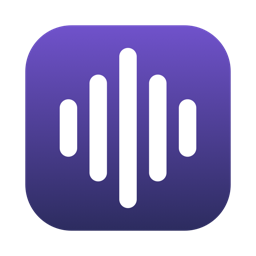

<p align="center">
  
</p>

<h1 align="center">Hark</h1>

<p align="center">
  Hold a key, talk, let go — your words are typed into whatever app you're using.<br>
  Speech recognition runs entirely on your Mac. Nothing is sent anywhere.
</p>

---

Hark is a small menu bar app for system-wide dictation on Apple Silicon Macs. It works in any
text field: your editor, terminal, browser, Slack, or a coding agent like Claude Code.

It's built on [Whistle](https://cactuscompute.com/blog/whistle), a 17 MB open speech-to-text
model from Cactus Compute, running on the CPU through the Needle engine. A typical sentence is
transcribed in about 30 ms.

## Features

- **Hold-to-talk anywhere.** Hold <kbd>Right Option</kbd> (or <kbd>Right ⌘</kbd> / <kbd>Fn</kbd>),
  speak, release. The text is pasted at your cursor.
- **Private by design.** Fully offline, no accounts, no telemetry. The mic is open only while you
  hold the key. See [SECURITY.md](SECURITY.md).
- **Live feedback.** A floating pill shows *Listening…* with bars that move with your voice
  (and stay still for background noise), then a spinner while transcribing.
- **Ignores the room.** Background voices, a TV, or a fan don't count as you speaking; if only
  background sound was heard, nothing is pasted.
- **Seven languages.** English, German, French, Spanish, Italian, Dutch and Polish, auto-detected
  or fixed from the menu.
- **Tiny and fast.** 17 MB app, ~50 MB of memory, ready ~0.1 s after launch.
- **Plays nice with your clipboard.** It's restored after pasting, and clipboard managers are
  told to ignore the dictated text.

## Install

Requires a Mac with Apple Silicon and macOS 13 or later (developed and tested on macOS 26).

### Homebrew (recommended)

```sh
brew install debanjanc01/tap/hark
ln -sf "$(brew --prefix)/opt/hark/Hark.app" /Applications/Hark.app
open /Applications/Hark.app
```

Homebrew builds Hark from source on your Mac (about a minute), so macOS doesn't show an
"unidentified developer" warning. You'll need the Xcode Command Line Tools
(`xcode-select --install`), which Homebrew already requires.

### Download

Grab `Hark-x.y.z.zip` from the [latest release](https://github.com/debanjanc01/hark/releases/latest),
unzip it, and drag **Hark.app** to **Applications**.

> [!NOTE]
> Release builds are not yet notarized by Apple, so the first launch is blocked. Open
> **System Settings → Privacy & Security**, scroll down, and click **Open Anyway** next to the
> Hark message. You only need to do this once. You can check the download against the
> `.sha256` file published with each release.

### From source

```sh
git clone https://github.com/debanjanc01/hark.git
cd hark
make install   # builds, copies to /Applications and opens it
```

## First run

Hark lives in the menu bar (look for the waveform icon); it has no Dock icon or window.
macOS will ask for three permissions:

| Permission | Why |
| --- | --- |
| **Microphone** | To hear you while you hold the hotkey. |
| **Input Monitoring** | To notice the hotkey from any app. |
| **Accessibility** | To paste the transcript into the app you're using. |

If you dismiss a prompt, the menu bar icon turns into a crossed-out waveform, and the menu has a
**Grant … Access** item that takes you to the right page in System Settings.

## Usage

1. Put your cursor where the text should go.
2. Hold <kbd>Right Option</kbd> and speak. The pill near the bottom of the screen shows
   *Listening…*, and its bars move with your voice.
3. Let go. You'll see *Transcribing…* briefly, then the text appears.

If you press another key while holding the hotkey (say <kbd>⌥</kbd><kbd>←</kbd> to jump a word),
Hark treats it as a normal shortcut and cancels the dictation.

### Menu

- **Hotkey**: Right Option, Right Command or Fn.
- **Language**: auto-detect, or force one of the seven supported languages.
- **Show On-Screen Indicator**: turn the floating pill off if you only want the menu bar icon.
- **Launch at Login**: start Hark automatically.

### Command line

The app binary can also transcribe audio files, which is handy for scripting and debugging:

```sh
/Applications/Hark.app/Contents/MacOS/Hark --transcribe recording.m4a
# {"audio_seconds":4.1,"language":"en","load_ms":11,"text":"…","transcribe_ms":[33.2]}
```

## Troubleshooting

- **Nothing happens when I hold the key.** Check Input Monitoring is on for Hark in
  System Settings → Privacy & Security, then quit and reopen Hark.
- **The pill shows but text never appears.** Accessibility is off for Hark. Turn it on in
  System Settings → Privacy & Security → Accessibility, then dictate again.
- **The bars don't move / "No speech heard".** Check the right mic is selected in
  System Settings → Sound → Input, and speak a little closer to it. Hark ignores sound that's
  only slightly louder than the room, so a very quiet voice in a noisy room may not register.
- **Permissions stopped working after an update.** macOS ties permissions to the app's code
  signature, and unsigned builds get a new one each time. Remove Hark from the three
  permission lists, then reopen it and grant them again.
- **Logs.** `log stream --predicate 'subsystem == "io.github.debanjanc01.hark"'`.
  Transcript text is redacted in logs.

## Development

```sh
make test    # fetches the engine + model (pinned, checksum-verified) and runs the tests
make run     # builds build/Hark.app and opens it
make dist    # zip + SHA-256 for a release
scripts/benchmark.sh [python-with-cactus-needle]   # performance comparison
```

The tests synthesize speech with macOS's `say`, so they exercise the real model without
checked-in audio fixtures.

### Layout

```
Sources/
  CNeedle/        C module for the Needle engine header (libneedle.a is fetched to vendor/)
  HarkCore/    Testable logic: Transcriber, AudioRecorder, VoiceMeter, HotkeyMonitor,
                  TextInserter, Permissions, Settings
  Hark/        The menu bar app: DictationController, StatusItemController, IndicatorPanel
Tests/            Swift Testing suites
scripts/          fetch-deps.sh, build-app.sh, benchmark.sh, make-icon.swift
packaging/        Homebrew formula
```

### Why Swift

The Needle engine does the heavy lifting, so it runs at the same speed from any language. What
differs is everything around it. Swift links the engine directly and needs no bundled runtime,
and it gets first-class access to the macOS APIs a dictation app depends on: audio, event taps,
the menu bar and permissions.

Measured on an M4 Pro with `scripts/benchmark.sh`, compared with the same model through
the Python SDK:

| | Hark (Swift) | Python SDK |
| --- | --- | --- |
| Model load | **11 ms** | 363–385 ms |
| Process start → first transcript | **0.1–0.3 s** | 0.6–0.8 s |
| Transcribe a 4 s clip | **32 ms** | 33 ms |
| Transcribe a 12 s clip | **91 ms** | 104 ms |
| Peak memory | **46–49 MB** | 102–108 MB |

## Releasing

1. Bump `VERSION` and commit.
2. Tag and push: `git tag v$(cat VERSION) && git push --tags`. CI runs the tests, builds the
   app and publishes a GitHub release with the zip and its SHA-256.
3. Update `url` and `sha256` in the tap's `Formula/hark.rb` (template in
   `packaging/homebrew/`).

To ship signed, notarized builds (no "Open Anyway" step), add these repository secrets from an
Apple Developer account: `MACOS_CERTIFICATE` (base64 Developer ID .p12),
`MACOS_CERTIFICATE_PASSWORD`, `CODESIGN_IDENTITY`, `APPLE_ID`, `APPLE_TEAM_ID` and
`APPLE_APP_PASSWORD`.

## Credits and license

Hark is released under the [MIT License](LICENSE).

Speech recognition is by the [Whistle](https://huggingface.co/Cactus-Compute/whistle) model and
the [Needle](https://github.com/cactus-compute/needle) engine from
[Cactus Compute](https://cactuscompute.com), both Apache-2.0. See
[THIRD_PARTY_NOTICES.md](THIRD_PARTY_NOTICES.md).
